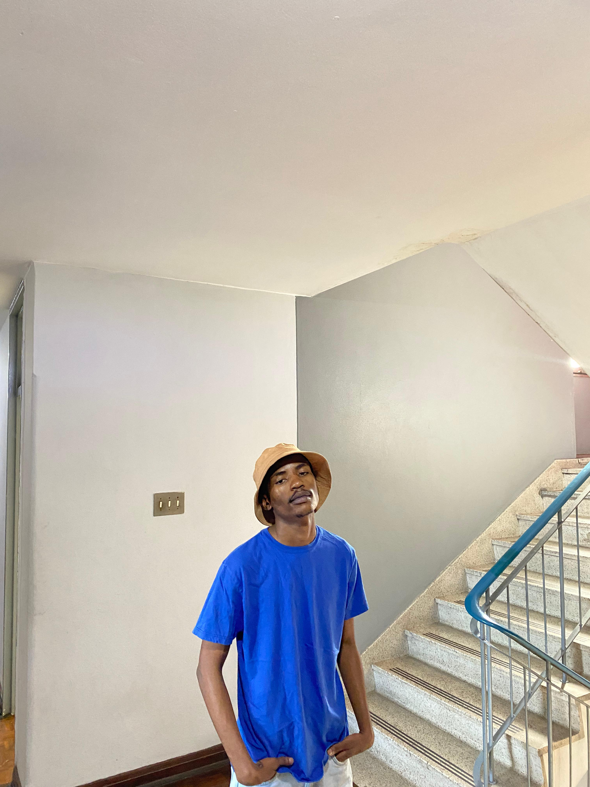

  

<h1 align="center">Hi, I'm Lizalise Hlangani 👋</h1>

  ICT | Networking | IT Support | Application Development

I'm building my journey in Information and Communication Technology, with a growing interest in computer networking, IT support and application development.

I enjoy understanding how technology works, solving technical problems and developing practical solutions. I'm using GitHub to document what I learn, practise my skills and share my progress.

## 👨‍💻 About Me

- 🎓 Background in Information and Communication Technology at Durban University of Technology (DUT).
- 🖧 Interested in computer networking, network configuration and troubleshooting.
- 🛠️ Exploring IT support and systems administration.
- 💻 Developing my programming and web development skills.
- 📚 Committed to continuous learning and hands-on practice.

## 🧰 Technologies & Skills

**Programming and Web Development**
- C#
- Java
- JavaScript
- HTML and CSS
- Razor

**Databases and Other Technologies**
- SQL
- Microsoft Azure fundamentals

**Networking and IT**
- Cisco Packet Tracer
- Networking fundamentals
- Network devices and initial configuration
- Linux fundamentals
- Cybersecurity fundamentals

## 📜 Learning & Certifications

I'm developing my technical knowledge through online learning, practical exercises and networking courses.

Topics I've explored include:
- Network Basics
- Networking Devices and Initial Configuration
- Introduction to Cybersecurity
- Linux fundamentals
- Internet of Things (IoT) and Digital Transformation

## 🚀 My Goals

- Build practical networking and IT support projects.
- Improve my programming and troubleshooting abilities.
- Gain hands-on experience with systems and networks.
- Document my learning and technical progress.
- Develop a portfolio that demonstrates my skills through real work.

## 📂 Projects

I'm currently working on developing my first projects. As I complete them, I'll add links and documentation here to show what I've built, the technologies I've used and what I've learned.

## 🤝 Connect With Me

- **GitHub:** Liza-lise
- **LinkedIn:** www.linkedin.com/in/lizalise-hlangani-87b4a82a8.

*Learning continuously. Building practically. Growing through technology.
